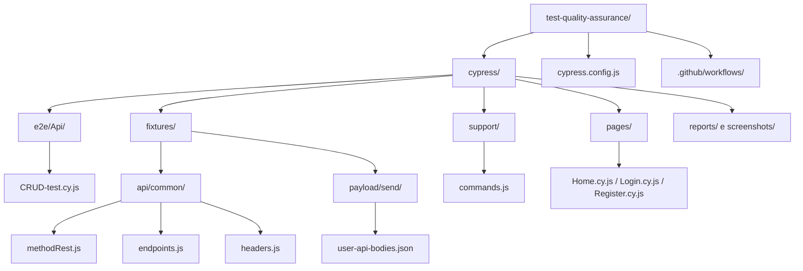
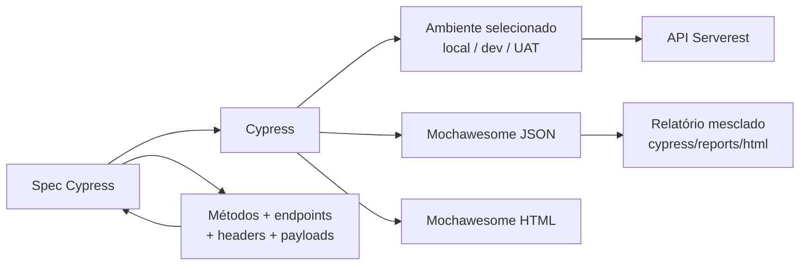

# 🧪 Automação de API com Cypress

Projeto de testes automatizados para a [API Serverest](https://serverest.dev/), com foco em qualidade, manutenção simples e visibilidade dos resultados.


## ✨ O que o projeto demonstra

- Testes de API positivos e negativos para autenticação e CRUD de usuários.
- Seleção de ambientes local, dev e UAT sem editar os testes.
- Métodos HTTP, endpoints, headers e payloads centralizados para facilitar manutenção.
- Relatórios HTML e JSON com Mochawesome.
- Execução automatizada por GitHub Actions.

## 🚀 Comece em poucos passos

### Ferramentas

- [Node.js 20, 22 ou 24+](https://nodejs.org/en/download/) e npm (incluído no instalador do Node.js).
- [Cypress: instalação e primeiros passos](https://docs.cypress.io/app/get-started/install-cypress).
- [Visual Studio Code](https://code.visualstudio.com/download) é opcional, mas recomendado.

### Instalar dependências

Na raiz do projeto:

```bash
npm ci
```

### Rodar apenas os testes

```bash
npm test
```

### Rodar os testes e gerar o relatório

```bash
npm run report
```

Para abrir o Cypress em modo interativo:

```bash
npm run test:headed
```

No Windows PowerShell, use `npm.cmd` caso o comando `npm` esteja bloqueado pela política de execução:

```powershell
npm.cmd test
```

```powershell
npm.cmd run report
```

## 🌍 Ambientes

As URLs são mantidas em `cypress/config/environments.js`; o ambiente padrão é `dev`. Os testes usam o `baseUrl` selecionado pela configuração do Cypress.

| Ambiente | URL |
| --- | --- |
| `local` | `http://localhost:3000` |
| `dev` | `https://serverest.dev` |
| `uat` | Definida em `UAT_URL` |

Exemplos para PowerShell:

```powershell
# Ambiente local
$env:TEST_ENVIRONMENT = 'local'
npm.cmd test
```

```powershell
# UAT: informe a URL real do ambiente
$env:TEST_ENVIRONMENT = 'uat'
$env:UAT_URL = 'https://seu-endereco-uat'
npm.cmd test
```

UAT sem `UAT_URL` configurada é interrompido com uma mensagem explicativa. Para usar dev, defina `$env:TEST_ENVIRONMENT = 'dev'` ou remova a variável da sessão.

## 🧭 Como a automação está organizada



| Local | Responsabilidade |
| --- | --- |
| `cypress/config/environments.js` | URLs e seleção de ambiente |
| `cypress/fixtures/api/common/methodRest.js` | Métodos HTTP (`GET`, `POST`, `PUT`, `DELETE`) |
| `cypress/fixtures/api/common/endpoints.js` | Caminhos dos endpoints |
| `cypress/fixtures/api/common/headers.js` | Headers JSON e autorização |
| `cypress/fixtures/payload/send/user-api-bodies.json` | Corpos de requisição e dados fixos |
| `cypress/e2e/Api/CRUD-test.cy.js` | Cenários de API |
| `cypress/support/commands.js` | Comandos reutilizáveis do Cypress |
| `cypress/reports/` | Relatórios gerados durante a execução |
| `cypress/screenshots/` | Evidências de cenários que falharam |

Os e-mails de usuários criados são gerados com sufixo único por execução para reduzir conflitos entre cenários.

## 🔄 Fluxo de execução



## ✅ Cenários cobertos

- Login válido e credenciais inválidas.
- Listagem de usuários.
- Cadastro válido e rejeição de campos obrigatórios vazios.
- Busca por ID e tratamento de usuário inexistente.
- Atualização de usuário.
- Exclusão de usuário e rejeição quando existe carrinho associado.

## 📊 Relatórios

O comando `npm run report` executa os testes, combina os arquivos JSON e gera o relatório HTML. Os resultados ficam em `cypress/reports/`; o HTML combinado fica em `cypress/reports/html/`.

> **Atenção:** atualmente, os scripts `test` e `test:ci` incluem `|| true` para permitir que a geração do relatório continue mesmo com cenários falhando. Por isso, valide o resumo do Cypress ou abra o relatório; o código de saída do npm, sozinho, não garante que a suíte passou.

## 🤖 Integração contínua

Os workflows em `.github/workflows/` executam os testes em GitHub Actions e publicam relatórios como artefatos. Eles usam Node.js 20, compatível com o Cypress 15 deste projeto.